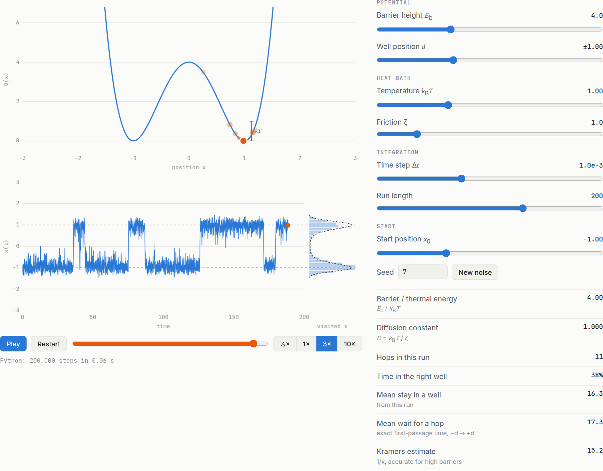

# Overdamped Langevin Dynamics

[](https://github.com/scichemcode/Overdamped_LD/actions/workflows/tests.yml)
[](LICENSE)
[](https://scichemcode.github.io/Overdamped_LD/)
[](https://colab.research.google.com/github/scichemcode/Overdamped_LD/blob/main/Overdamped_LD_Full.ipynb)

A small Python package for simulating a Brownian particle in a 1D double-well potential. It shows how the rate of transitions between the two states depends on the barrier height, and it checks every result against exact theory.

**▶ [Try the interactive Double-well lab in your browser](https://scichemcode.github.io/Overdamped_LD/)**: drag sliders for the barrier, temperature, friction and more, and watch the particle hop. Nothing to install.

<p align="center"></p>

## The model

$$U(x)=E_b\left[\left(\tfrac{x}{d}\right)^2-1\right]^2, \qquad \zeta\,\dot x = -U'(x)+\sqrt{2\zeta k_BT}\,\eta(t)$$

The potential has minima at $x=\pm d$ and a barrier of height $E_b$ at $x=0$. The dynamics are integrated with Euler–Maruyama using Gaussian noise:

$$x_{j+1}=x_j-\frac{\Delta t}{\zeta}U'(x_j)+\sqrt{2D\Delta t}\,\xi_j,\qquad D=k_BT/\zeta .$$

| | |
|---|---|
|  |  |


## Interactive lab

**Live at <https://scichemcode.github.io/Overdamped_LD/>**

[](https://scichemcode.github.io/Overdamped_LD/)

The lab runs this package's own `simulate` in your browser through [Pyodide](https://pyodide.org), Python compiled to WebAssembly. There's no server and nothing is pre-rendered. Python takes a few seconds to load the first time.

- **Sliders:** barrier height, temperature $k_BT$, friction $\zeta$, well position $d$, time step $\Delta t$, run length, start position and random seed. Each change reruns the simulation; a 200,000-step run takes about 0.05 s in the browser.
- **Animation:** the particle moves on the potential with a $k_BT$ scale bar, its trajectory $x(t)$ is drawn as it plays, and a histogram of visited positions fills in against the Boltzmann curve. You can play, pause, scrub and change the speed.
- **Readouts:** $E_b/k_BT$, $D$, hop count, time in each well, mean stay in a well, the exact mean wait for a hop, and the Kramers estimate. There's a warning when $\Delta t$ is too large for the chosen potential.
- **Same noise:** keeping the seed fixed reuses the same random kicks, so you can change one parameter and see its effect alone.

The page is `docs/index.html`, served by GitHub Pages from the `main` branch's `/docs` folder. After changing the package, rebuild it so the browser runs the same code the tests check:

```bash
overdamped-ld web          # bundles the package source into docs/index.html
python -m http.server -d docs   # optional: preview at http://localhost:8000
```

## What's in the box

| Module | Contents |
|---|---|
| `potentials` | `DoubleWell` (energy, force, curvature) plus a `Potential` protocol, so you can plug in your own landscape |
| `integrators` | `simulate` (many walkers run in parallel, seeded, strided, saved to `.npz`) and `first_passage_times` |
| `analysis` | `assign_states` (core sets with hysteresis), `count_transitions`, `transition_rate`, `dwell_times`, `populations`; theory: `boltzmann_density`, `mfpt_exact` (exact 1D quadrature), `kramers_rate` |
| `plotting` | The figures above |
| `web` | Builds the in-browser lab page (Pyodide) |
| `cli` | The `overdamped-ld` command |

## Install

```bash
pip install git+https://github.com/scichemcode/Overdamped_LD
# or, for development
git clone https://github.com/scichemcode/Overdamped_LD && cd Overdamped_LD
pip install -e ".[dev]"
```

## Usage

```python
import overdamped_ld as old

pot = old.DoubleWell.in_kT(4)                         # 4 kT barrier
traj = old.simulate(pot, x0=-1, n_steps=200_000, dt=1e-3,
                    n_walkers=64, stride=50, seed=0)  # traj.x has shape (frames, walkers)

states = old.assign_states(traj.x, core=0.5)
print("k_sim     ", old.transition_rate(states, traj.save_interval))
print("k_Kramers ", old.kramers_rate(pot))

fpt = old.first_passage_times(pot, -1, 1, n_walkers=500, seed=1)
print("MFPT sim  ", fpt.mean(), " exact ", old.mfpt_exact(pot, -1, 1))
```

From the command line:

```bash
overdamped-ld simulate --barrier 5 --steps 500000 --walkers 32 --out traj.npz
overdamped-ld rates --barriers 1 2 3 4 5 6 --walkers 500 --out rates.json
overdamped-ld figures --outdir docs/figures      # regenerate every figure in this README
```

## Validation

`pytest` checks the integrator against results with known answers:

* **Free diffusion:** $\langle x^2\rangle = 2Dt$
* **Harmonic well:** equipartition, $\mathrm{Var}(x)=k_BT/k$
* **Double well:** the sampled histogram matches $e^{-U/k_BT}/Z$
* **Kinetics:** the simulated mean first-passage time matches the exact quadrature, and the exact result converges to Kramers' rate as $E_b/k_BT\to\infty$
* **Implementation:** the force equals $-\nabla U$ (finite differences), seeds are reproducible, and the state assignment and dwell-time logic are correct

## Units

Energies are in units of $k_BT$, and the default parameters are `kT = 1` and `friction = 1`, which gives $D = 1$. The original notebook used `kT = 0.5` and $m\gamma = 0.5$, which also gives $D = 1$. Both are the same physics: only $E_b/k_BT$ and $D$ affect the dimensionless kinetics.

## License

[MIT](LICENSE) © 2026 Kriti Alam
