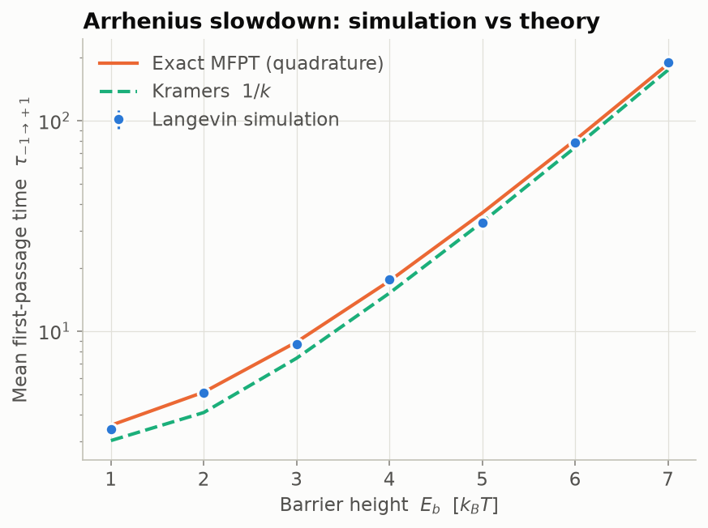
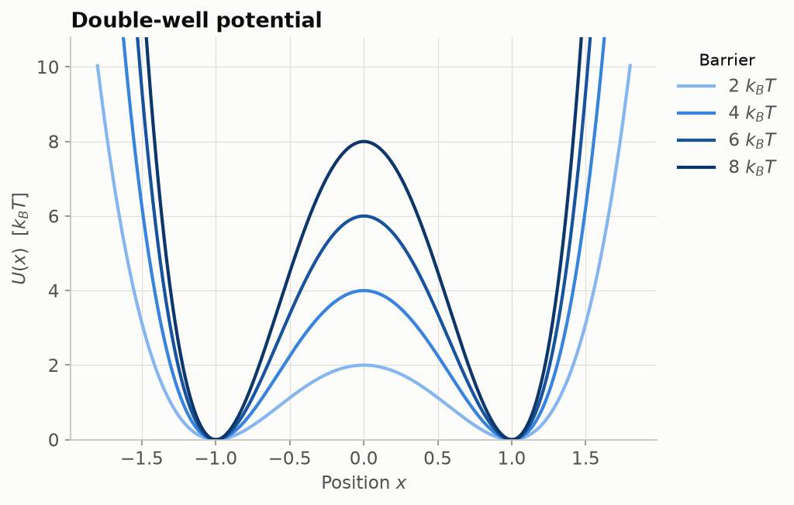
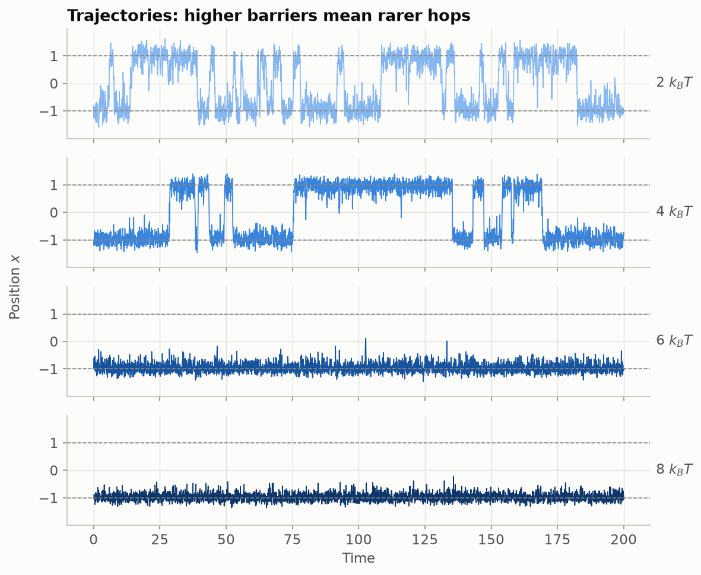
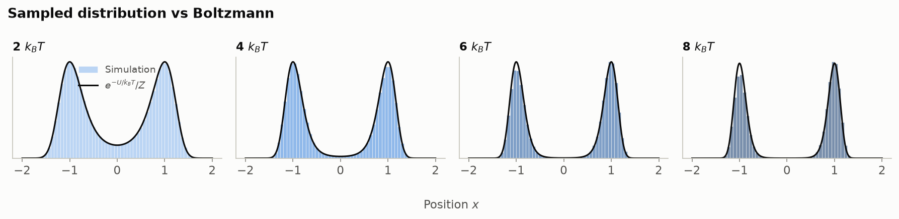

# Overdamped Langevin Dynamics

[](https://github.com/scichemcode/Overdamped_LD/actions/workflows/tests.yml)
[](LICENSE)
[](https://colab.research.google.com/github/scichemcode/Overdamped_LD/blob/main/Overdamped_LD_Full.ipynb)

A small Python package for simulating a Brownian particle in a 1D double-well potential. It shows how the rate of transitions between the two states depends on the barrier height, and it checks every result against exact theory.

<p align="center"></p>

## The model

$$U(x)=E_b\left[\left(\tfrac{x}{d}\right)^2-1\right]^2, \qquad \zeta\,\dot x = -U'(x)+\sqrt{2\zeta k_BT}\,\eta(t)$$

The potential has minima at $x=\pm d$ and a barrier of height $E_b$ at $x=0$. The dynamics are integrated with Euler–Maruyama using Gaussian noise:

$$x_{j+1}=x_j-\frac{\Delta t}{\zeta}U'(x_j)+\sqrt{2D\Delta t}\,\xi_j,\qquad D=k_BT/\zeta .$$

| | |
|---|---|
|  |  |



## Interactive explorer

`docs/index.html` is a live lab page. It runs this package's own `simulate` in the browser through [Pyodide](https://pyodide.org), Python compiled to WebAssembly, so there's no server and nothing is pre-rendered. Sliders for the barrier height, temperature, friction, well position, time step, run length, start position and seed rerun the simulation as you drag. A 200k-step run takes about 0.05 s in the browser.

The page animates the particle on the potential above its trajectory, which is drawn as it plays. Beside the trajectory, a histogram of visited positions fills in against the Boltzmann curve. A readout gives the hop count, time spent in each well, the exact mean wait time and the Kramers estimate. The page warns you when the time step is too large for the chosen potential.

```bash
overdamped-ld web          # bundles the package source into docs/index.html
```

To host it, turn on GitHub Pages for the `main` branch's `/docs` folder (**Settings → Pages**).

## What's in the box

| Module | Contents |
|---|---|
| `potentials` | `DoubleWell` (energy, force, curvature) plus a `Potential` protocol, so you can plug in your own landscape |
| `integrators` | `simulate` (many walkers run in parallel, seeded, strided, saved to `.npz`) and `first_passage_times` |
| `analysis` | `assign_states` (core sets with hysteresis), `count_transitions`, `transition_rate`, `dwell_times`, `populations`; theory: `boltzmann_density`, `mfpt_exact` (exact 1D quadrature), `kramers_rate` |
| `plotting` | The figures above |
| `web` | Builds the in-browser lab page (Pyodide) |
| `cli` | The `overdamped-ld` command |

## Install

```bash
pip install git+https://github.com/scichemcode/Overdamped_LD
# or, for development
git clone https://github.com/scichemcode/Overdamped_LD && cd Overdamped_LD
pip install -e ".[dev]"
```

## Usage

```python
import overdamped_ld as old

pot = old.DoubleWell.in_kT(4)                         # 4 kT barrier
traj = old.simulate(pot, x0=-1, n_steps=200_000, dt=1e-3,
                    n_walkers=64, stride=50, seed=0)  # traj.x has shape (frames, walkers)

states = old.assign_states(traj.x, core=0.5)
print("k_sim     ", old.transition_rate(states, traj.save_interval))
print("k_Kramers ", old.kramers_rate(pot))

fpt = old.first_passage_times(pot, -1, 1, n_walkers=500, seed=1)
print("MFPT sim  ", fpt.mean(), " exact ", old.mfpt_exact(pot, -1, 1))
```

From the command line:

```bash
overdamped-ld simulate --barrier 5 --steps 500000 --walkers 32 --out traj.npz
overdamped-ld rates --barriers 1 2 3 4 5 6 --walkers 500 --out rates.json
overdamped-ld figures --outdir docs/figures      # regenerate every figure in this README
```

## Validation

`pytest` checks the integrator against results with known answers:

* **Free diffusion:** $\langle x^2\rangle = 2Dt$
* **Harmonic well:** equipartition, $\mathrm{Var}(x)=k_BT/k$
* **Double well:** the sampled histogram matches $e^{-U/k_BT}/Z$
* **Kinetics:** the simulated mean first-passage time matches the exact quadrature, and the exact result converges to Kramers' rate as $E_b/k_BT\to\infty$
* **Implementation:** the force equals $-\nabla U$ (finite differences), seeds are reproducible, and the state assignment and dwell-time logic are correct

## Units

Energies are in units of $k_BT$, and the default parameters are `kT = 1` and `friction = 1`, which gives $D = 1$. The original notebook used `kT = 0.5` and $m\gamma = 0.5$, which also gives $D = 1$. Both are the same physics: only $E_b/k_BT$ and $D$ affect the dimensionless kinetics.

## License

[MIT](LICENSE) © 2026 Kriti Alam
